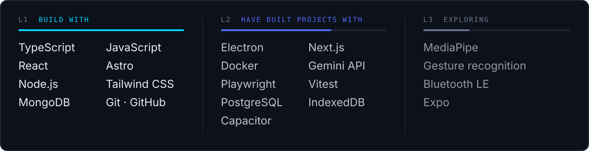

<picture>
  <source media="(prefers-color-scheme: light)" srcset="assets/banner-light.svg">
  
</picture>

 

> I don't just write code. I build ideas into experiences, systems and products.

I'm a Software Engineering student at FESC, Colombia. I like to understand a problem before I write a line for it,
then carry the idea all the way to something people can use: the interface, the data, the rules behind it.
I'm early in my path and building in public, so every project below says honestly where it stands.

`PRODUCT DEVELOPMENT` &nbsp; `SOFTWARE ENGINEERING` &nbsp; `ARTIFICIAL INTELLIGENCE` &nbsp; `HUMAN-COMPUTER INTERACTION` &nbsp; `DIGITAL EXPERIENCES`

 

## Selected work

<picture>
  <source media="(prefers-color-scheme: light)" srcset="assets/card-syndes-light.svg">
  
</picture>

  <picture>
    <source media="(prefers-color-scheme: light)" srcset="assets/card-tea-light.svg">
    
  </picture>
  <picture>
    <source media="(prefers-color-scheme: light)" srcset="assets/card-anillo-light.svg">
    
  </picture>

<picture>
  <source media="(prefers-color-scheme: light)" srcset="assets/card-ypri-light.svg">
  
</picture>

 

## Stack

<picture>
  <source media="(prefers-color-scheme: light)" srcset="assets/stack-light.svg">
  
</picture>

 

## Now

| Building | Learning |
|---|---|
| Syndes: getting it ready for its first businesses | Software architecture and system design |
| Anillo Lab: from webcam gestures to the ring's hardware | Embedded systems with ESP32 and Bluetooth LE |

 

<picture>
  <source media="(prefers-color-scheme: light)" srcset="assets/activity-light.svg">
  
</picture>

 

<b>Leer en español</b>

 

> No me limito a escribir código. Convierto ideas en experiencias, sistemas y productos.

Soy estudiante de Ingeniería de Software en la FESC, en Colombia. Me gusta entender un problema antes de escribir una línea para resolverlo
y llevar la idea hasta algo que la gente pueda usar: la interfaz, los datos y las reglas que hay detrás.
Estoy al comienzo de mi camino y construyo en público, así que cada proyecto dice con honestidad en qué punto está.

**Proyectos**

- **Syndes** (cofundador, en desarrollo): software para operar un negocio, con punto de venta, inventario, ventas y finanzas.
- **project_Tea** (prototipo): aprendizaje de electrónica digital pensado para estudiantes universitarios neurodivergentes. Presentado en RedCOLSI Nacional.
- **Anillo Lab** (prototipo de software): controlar el computador con gestos de la mano. Hoy funciona con la cámara; el anillo físico está en diseño.
- **YPRI** (concepto): un marketplace móvil que conecta a quien necesita un servicio con profesionales que lo ofrecen.

**Ahora** construyo Syndes y llevo Anillo Lab al hardware, mientras aprendo arquitectura de software y sistemas embebidos.

 

  <a href="https://github.com/jodaripaa"><code>GITHUB</code></a>
  <!-- Pendiente: LinkedIn, correo profesional y portafolio cuando estén confirmados -->

