<picture>
  <source media="(prefers-color-scheme: light)" srcset="assets/banner-light.svg">
  
</picture>

 

> I don't just write code. I build ideas into experiences, systems and products.

Software engineering student and product builder. I take ideas from the first sketch to something people can use:
the interface, the data and the rules behind it. Every project below says honestly where it stands.

`PRODUCT DEVELOPMENT` &nbsp; `SOFTWARE ENGINEERING` &nbsp; `ARTIFICIAL INTELLIGENCE` &nbsp; `HUMAN-COMPUTER INTERACTION` &nbsp; `DIGITAL EXPERIENCES`

 

<picture>
  <source media="(prefers-color-scheme: light)" srcset="assets/sheet-02-light.svg">
  
</picture>

<picture>
  <source media="(prefers-color-scheme: light)" srcset="assets/card-syndes-light.svg">
  
</picture>

  <picture>
    <source media="(prefers-color-scheme: light)" srcset="assets/card-tea-light.svg">
    
  </picture>
  <picture>
    <source media="(prefers-color-scheme: light)" srcset="assets/card-anillo-light.svg">
    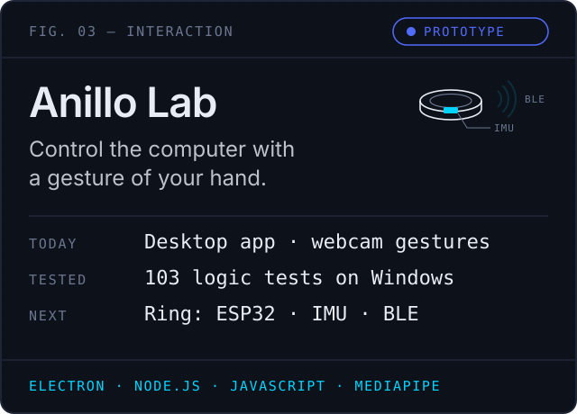
  </picture>

<picture>
  <source media="(prefers-color-scheme: light)" srcset="assets/card-ypri-light.svg">
  
</picture>

 

<picture>
  <source media="(prefers-color-scheme: light)" srcset="assets/sheet-03-light.svg">
  
</picture>

<picture>
  <source media="(prefers-color-scheme: light)" srcset="assets/bom-light.svg">
  
</picture>

 

<picture>
  <source media="(prefers-color-scheme: light)" srcset="assets/sheet-04-light.svg">
  
</picture>

<picture>
  <source media="(prefers-color-scheme: light)" srcset="assets/now-light.svg">
  
</picture>

 

<picture>
  <source media="(prefers-color-scheme: light)" srcset="assets/sheet-05-light.svg">
  
</picture>

<picture>
  <source media="(prefers-color-scheme: light)" srcset="assets/activity-light.svg">
  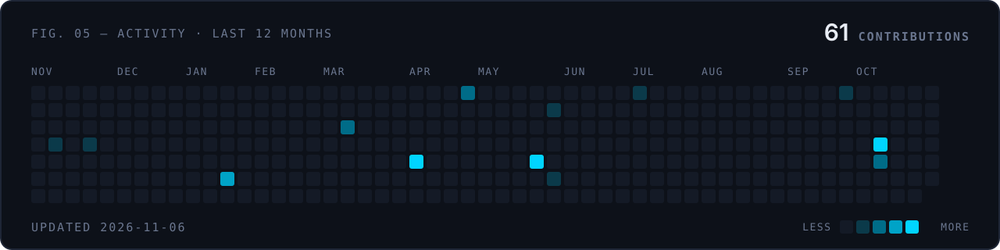
</picture>

 

<b>Leer en español</b>

 

> No me limito a escribir código. Convierto ideas en experiencias, sistemas y productos.

Estudiante de ingeniería de software y constructor de productos. Llevo las ideas desde el primer boceto hasta algo que la gente pueda usar:
la interfaz, los datos y las reglas que hay detrás. Cada proyecto dice con honestidad en qué punto está.

**Proyectos**

- **Syndes** (cofundador, en desarrollo): software para operar un negocio, con punto de venta, inventario, ventas y finanzas.
- **project_Tea** (prototipo): electrónica digital pensada para estudiantes universitarios neurodivergentes. Presentado en RedCOLSI Nacional.
- **Anillo Lab** (prototipo de software): controlar el computador con gestos de la mano. Hoy funciona con la cámara; el anillo está en diseño.
- **YPRI** (concepto): un marketplace móvil que conecta a quien necesita un servicio con profesionales que lo ofrecen.

**Inventario**: cada tecnología con el número de proyectos donde aparece, contado desde los manifiestos de cada proyecto.

**Ahora** construyo Syndes y llevo Anillo Lab al hardware, mientras aprendo arquitectura de software y sistemas embebidos.

 

<picture>
  <source media="(prefers-color-scheme: light)" srcset="assets/footer-light.svg">
  
</picture>

  <a href="https://github.com/jodaripaa"><code>GITHUB</code></a>
  <!-- Pendiente: LinkedIn, correo profesional y portafolio cuando estén confirmados -->

